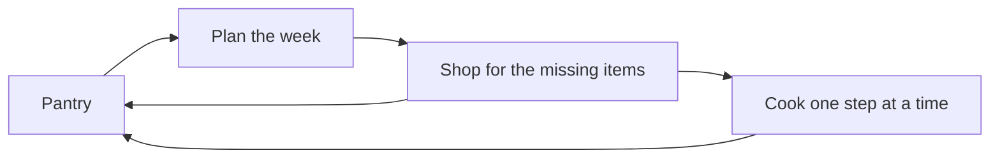

Wiki

# Obsidian pivot

The kitchen tool is a plugin for Obsidian. This page gives the full picture. Each part has its own page.

## The idea

Your recipes are notes in your vault. The plugin adds a pantry to that vault. Because it knows what you have, it can tell you what to cook, what to buy, and what to use first.

## The loop

The plugin has one loop, and the pantry is its center.

1. **Plan.** You choose the meals of the week from the recipes that use up your pantry.
2. **Shop.** The list has only the items that are missing.
3. **Cook.** You cook one step at a time.
4. **Update.** A cooked meal takes its food out of the pantry. A shopping trip puts food in.

Each turn of the loop starts with a correct pantry, so the next plan is correct too.

## The pages

| Page                    | What you learn                                                                   |
| ----------------------- | -------------------------------------------------------------------------------- |
| [Vision](vision.md)     | The true north: the problem, the result that the plugin must give, why Obsidian. |
| [Features](features.md) | What the plugin does for you, and why each part is worth its place.              |
| [Roadmap](roadmap.md)   | What is left between the plugin of today and the features, in sequence.          |

## An example

On Sunday, the pantry has rice, a can of coconut milk, and chicken that you must use soon. The plugin puts the chicken curry at the top of the recipes, with "7 of 9 in the pantry". You add it to the week. The shopping list gets the two missing items: limes and ginger.

## Further reading

- [Documentation standards](documentation-standards.md): the rules for a new page in this wiki.
- [Build a plugin](https://docs.obsidian.md/Plugins/Getting+started/Build+a+plugin): the guide from Obsidian on how to build, load, and reload a plugin.
