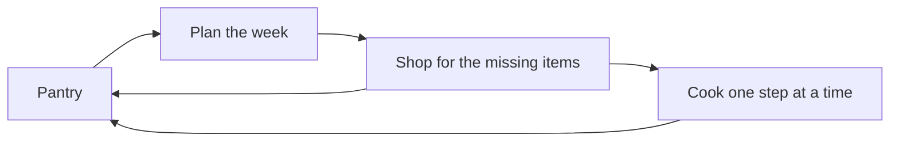

Wiki

# What's for Dinner

What's for Dinner is a plugin for Obsidian that makes your vault a kitchen. This page gives the full picture. Each part has its own page.

## The idea

Your recipes are notes in your vault. The plugin adds a pantry to that vault. Because it knows what you have, it can tell you what to cook, what to buy, and what to use first.

## The loop

The plugin has one loop, and the pantry is its center.

1. **Plan.** You choose the meals of the week from the recipes that use up your pantry.
2. **Shop.** The list has only the items that are missing.
3. **Cook.** You cook one step at a time.
4. **Update.** A cooked meal takes its food out of the pantry. A shopping trip puts food in.

Each turn of the loop starts with a correct pantry, so the next plan is correct too.

## An example

On Sunday, the pantry has rice, a can of coconut milk, and chicken that you must use soon. The plugin puts the chicken curry at the top of the recipes, with "7 of 9 in the pantry". You add it to the week. The shopping list gets the two missing items: limes and ginger.

## The way into the wiki

Start with the page that has your question. Each page goes one step down, to more detail.

| Your question                             | Page                                                         |
| ----------------------------------------- | ------------------------------------------------------------ |
| Which problem does the plugin solve?      | [Vision](vision.md)                                          |
| What can you do with it?                  | [Features](features/README.md)                               |
| Where is the data?                        | [Notes of the kitchen](architecture/notes-of-the-kitchen.md) |
| How does the plugin know what you have?   | [Pantry](architecture/pantry.md)                             |
| How does it select a recipe?              | [Recipes](architecture/recipes.md)                           |
| How does the week work?                   | [Plan](architecture/plan.md)                                 |
| How does the list know what is missing?   | [Shopping](architecture/shopping.md)                         |
| What occurs when you cook?                | [Cook Mode](architecture/cook-mode.md)                       |
| How does a new vault start?               | [Setup](architecture/setup.md)                               |
| Which settings are there?                 | [Settings](architecture/settings.md)                         |
| How does each screen get the same look?   | [Look](architecture/look.md)                                 |
| What does a word mean?                    | [Glossary](glossary.md)                                      |
| Who uses the plugin, and in which moment? | [Personas](personas.md)                                      |
| What is left to build?                    | [Roadmap](features/roadmap.md)                               |
| How does an idea become code?             | [Workflow](standards/workflow.md)                            |
| How is the code written?                  | [Code standards](standards/code-standards.md)                |
| How is a rule tested?                     | [Unit tests](standards/unit-tests.md)                        |

## Further reading

- [Documentation standards](standards/documentation-standards.md): the rules for a new page in this wiki.
- [Build a plugin](https://docs.obsidian.md/Plugins/Getting+started/Build+a+plugin): the guide from Obsidian on how to build, load, and reload a plugin.
