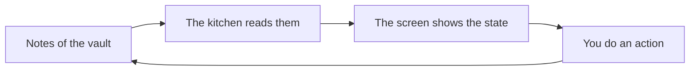

[Wiki](../README.md) / Notes of the kitchen

# Notes of the kitchen

The plugin has no database. All that it knows is in notes of your vault. This page tells which notes those are, and what occurs when one of them changes.

## Why the data is in notes

Only its program can read a database. If the program stops, your data stops with it. A note is text that you can read and change with no plugin. So the vault is the only source of the kitchen.

## Four kinds of notes

| Note      | One note for            | Where it is                                   |
| --------- | ----------------------- | --------------------------------------------- |
| Recipe    | Each recipe             | The recipes folder of the settings            |
| Food item | Each food of the pantry | The pantry folder of the settings             |
| Plan      | The meals of the week   | The plan note of the settings: `Meal plan.md` |
| Shopping  | Each shopping trip      | The shopping folder of the settings           |

A food item note can also come from a recipe: [intake](intake.md) makes a stub in the pantry folder for each new food.

The photos of a recipe are not notes. They are in the folder `Photos` of the recipes folder, such as `Recipes/Photos`, so that a recipe and its photos move as one unit. The plugin makes that folder when it saves the first photo. The photos of the [brands](brands.md) are in the folder `Photos` of the pantry folder, such as `Larder/Pantry/Photos`, for the same reason.

A [recipe](recipes.md) follows a public format. A [food item](food-item-note.md), the [plan](plan.md), and a [shopping trip](shopping-note.md) have a form of the plugin, and you can write each of them by hand.

## Each change goes through a note

When the kitchen opens, the plugin reads these notes. After that, it follows the vault: a new note, a changed note, a note with a new name, and a note that is gone.

An action in the kitchen does not change the screen directly. It writes the note. The vault reports the change, and the plugin reads the note again. Then the screen shows the new state.

Thus a change that you type in a note and a change that the plugin makes take the same path. The screen cannot show a fact that is not in a note.

## An example

The chicken curry needs 500 g of chicken thighs, and the outside fridge has 500 g. You cook the curry and tap "Update the pantry". The plugin takes the row "Outside fridge" out of the table in the note `Chicken thighs`. The vault reports the change. The plugin reads the note and finds no row. The pantry shows chicken thighs as out.

## What is not in a note

Three things are not facts of the kitchen, so they are in the data file of the plugin:

- your [settings](settings.md), with the list of your places
- the [suggestions](suggestions.md) that you skipped
- the step of [setup](setup.md), and if setup is complete

The cart is not in that file. The plugin reads the data file one time, when it starts. So a cart in that file is not the same on your phone and on your computer.

## Further reading

- [Glossary](../glossary.md): the meaning of "food item", "row", and the other words of the kitchen.
- [Cook Mode](cook-mode.md): all that the plugin writes when you finish a meal.
