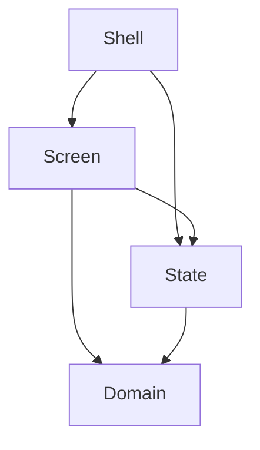

[Wiki](../README.md) / [Code standards](code-standards.md) / Layers

# Layers

A layer is a group of files with the same kind of job. The rule between the layers is one sentence: a file imports only from its own layer, or from a layer below it.

## Why the direction is important

Obsidian and the screens change often. The rules of the kitchen change seldom, and they are the reason for the plugin. If a rule imports a screen, a change of the look is a risk for the rule.

So the imports go one way: to the rules. Then a change at the top cannot break the bottom. And you can read a rule, and run it, with no Obsidian and no screen.

## The four layers

| Layer  | Files                                                              | Its job                                                              | It does not                                      |
| ------ | ------------------------------------------------------------------ | -------------------------------------------------------------------- | ------------------------------------------------ |
| Shell  | `main.ts`, `kitchen-view.svelte.ts`, `settings-tab.ts`             | Connects the plugin to Obsidian: the tab, the command, the settings. | Decide a rule of the kitchen.                    |
| Screen | `ui/`                                                              | Shows what it gets, and tells what you did.                          | Read or write a note, or decide a rule.          |
| State  | `kitchen-state.svelte.ts`, `kitchen/*-actions.ts`, `read-properties.ts` | Keeps the notes of the vault current, and has each action.      | Know a component.                                |
| Domain | All other files: a folder for each subject, `units.ts`, `dates.ts` | The rules of the kitchen.                                            | Import Obsidian, Svelte, the state, or a screen. |

The shell and the state are the only files that import Obsidian. That is five files. When Obsidian changes, no other file changes.

## The folders of the domain tell what the plugin is

The folders of the domain have names from the kitchen: `pantry`, `recipes`, `plan`, `shop`, and `cook`. Two more have the name of their one subject: `match`, and `recipemd` for the format of a recipe. A reader who sees only the names of the folders knows that this is a kitchen. A folder with the name `utils` or `helpers` tells nothing, so the code has none.

## An example: a new amount of rice

1. The pantry screen calls `setStocks` of the kitchen state, with the new rows.
2. The state asks Obsidian for the note of the rice.
3. The domain function `replaceStocks` gets the text of the note and the rows, and it gives the new text.
4. The state gives that text back to Obsidian.

Only step 3 knows the form of a food item note, and it is a [pure function](functions.md). Only steps 2 and 4 know Obsidian.

## Further reading

- [One file, one job](one-file-one-job.md): where a piece goes when a file has two jobs.
