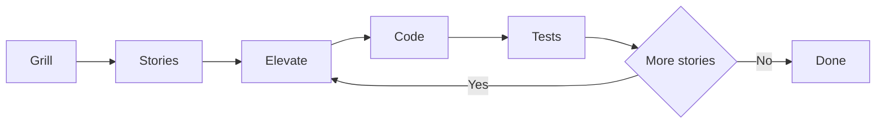

[Wiki](../README.md) / Workflow

# Workflow

Each change of the plugin starts as words and ends as code. This page tells the steps between the two, and which folder of the wiki holds the work at each step.

## Why the pages come before the code

Code that comes first decides things that nobody decided. A page is easy to change, and code is not. So you discuss a possibility first. Then you divide it into small pieces of work. Only then you build it.

## Three folders, three states

| Folder                | State    | What it has                                                 |
| --------------------- | -------- | ----------------------------------------------------------- |
| `initiatives/<slug>/` | Possible | The discussion of one piece of work. It is not reality yet. |
| `features/<version>/` | Agreed   | User stories: the work in small pieces.                     |
| `architecture/`       | Real     | The system as it is. These pages agree with the code.       |

## The six steps

1. **Grill.** You make a folder for the initiative, and you discuss the feature there. The folder has a temporary glossary, where each new word gets its meaning. It has a decision log, where you explore the options and select a direction, with the reason. It can have more pages for detail, such as a flow chart, the connections of a schema, or the contract of an endpoint. All of this looks forward, but it starts from the code of today. The grill ends with a [spec](spec.md): one page with the scope that is agreed.
2. **Stories.** You divide the scope of the spec into [user stories](user-story.md). One agent or one person can complete a story. A story has a persona, requirements, acceptance criteria, and links to the stories that it depends on.
3. **Elevate.** The initiative goes from draft to architecture. You compare the story with the architecture pages and with the code, to see that they agree. Then you change the pages that must change, and you approve them before the code starts. It is the last moment in which a change is only words.
4. **Code.** The code follows the story and the pages that step 3 changed.
5. **Tests.** Each test must be useful. You do not make a test only to have a test. A rule of the domain gets a [unit test](unit-tests.md), and `npm test` runs each test. A rule of the screen or of the feel gets a check on the phone.
6. **Repeat.** You go back to the stories, and you do steps 3 to 6 for the next story, until all stories are done.

## Further reading

- [Page template](page-template.md): the form of a page, and the folders of the wiki.
- [Pull request](pull-request.md): the form of the message that puts a branch into the plugin.
- [Pantry stories](../features/v0.1.0/pantry-stories.md): the user stories of one feature, as a model.
